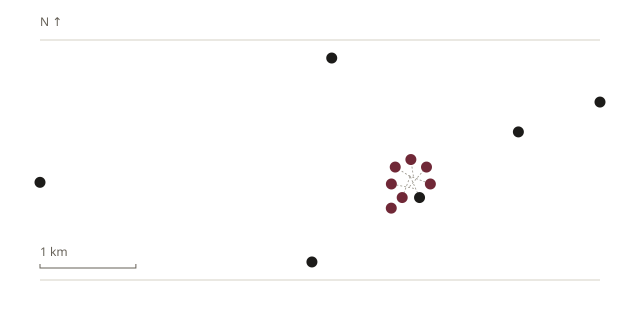

# Homepage real static geography — proposal

**PROPOSAL FOR REVIEW. No production implementation. Stage 6.3 remains COMPLETE; Stage 7 is not started.** This is a post-Stage-6.3 refinement. The user's latest direction supersedes approval of the abstract Homepage graphic; it does not reopen the completed interactive Map stage.

## Recommendation

Choose **A — real points only**, with north-up projection, restrained framing, a derived 1km reference bar and a clearly explained static screen-space fan for the dense Fili group. Remove all invented contour/boundary paths and the decorative “13”. Put the three localized Place detail links directly below the diagram, without “Например / For example”. Keep the catalog-derived lead and primary localized Map CTA.

This is a real coordinate overview of the collection, not a recognizable street/bank map of Moscow. Its limitation is the absence of a geographic landmark such as the river; north/scale and the true distribution distinguish it from the current decorative graphic. B would add a stronger Moscow reference, but requires a new verified geographic asset and licensing/provenance work. A satisfies the stated real-coordinate goal entirely with approved project data.

## 1. Audit and all 13 coordinates

Inspected only `app/pages/index.vue` (Map markup/styles/data), the RU/EN Place catalogs through the existing facade, `app/data/mapPresentation.ts`, and relevant Homepage/Map paragraphs of DESIGN/ARCHITECTURE. A targeted geographic-asset filename check in `public`, `app/data` and `docs/research` found no reusable GeoJSON/TopoJSON/Shapefile/KML/OSM river/base geometry. The existing approved marker SVG is a symbol, not geographic data. No unrelated historical research was read.

Both locales have identical coordinates, status/precision structure and the final 6/7 assignment from `statusLayer`. Decimal degrees below are copied from the existing records, not newly geocoded.

| Place ID | Latitude | Longitude | Existing layer |
| --- | ---: | ---: | --- |
| fili-village | 55.7397 | 37.5231 | 1812 · graphite |
| kutuzov-hut | 55.73972 | 37.52306 | Memory · burgundy |
| intercession-church-fili | 55.75083 | 37.51 | 1812 · graphite |
| kuntsevo-estate | 55.73917 | 37.46139 | 1812 · graphite |
| poklonnaya-hill | 55.7317 | 37.5067 | 1812 · graphite |
| dorogomilovskaya-gate | 55.7467 | 37.5547 | 1812 · graphite |
| dorogomilovskoe-cemetery | 55.7439 | 37.5411 | 1812 · graphite |
| brotherhood-grave-obelisk | 55.7398 | 37.5228 | Memory · burgundy |
| milepost-fili | 55.73972 | 37.52306 | Memory · burgundy |
| archangel-michael-chapel | 55.73972 | 37.52361 | Memory · burgundy |
| borodino-panorama-museum | 55.73877 | 37.52297 | Memory · burgundy |
| kutuzov-monument | 55.7386 | 37.5237 | Memory · burgundy |
| triumphal-arch | 55.73675 | 37.51992 | Memory · burgundy |

## 2. Bounding box

- Latitude: **55.7317–55.75083**; longitude: **37.46139–37.5547**.
- SW corner: **[37.46139, 55.7317]**; NE corner: **[37.5547, 55.75083]**, written `[lon, lat]`.
- Geographic bbox in GeoJSON order: **[37.46139, 55.7317, 37.5547, 55.75083]**.
- Coordinate span: **0.09331° longitude × 0.01913° latitude**.
- Local projected extent: approximately **5.841km east–west × 2.127km north–south**, aspect about **2.75:1**. These are spherical-model estimates, not surveyed distances.
- West extreme: Kuntsevo estate; east extreme: Dorogomilovskaya gate; north extreme: Intercession church; south extreme: Poklonnaya Hill. Keep all extremes and modest padding; do not crop the west outlier to enlarge Fili.

## 3. Projection

Recommend a local **spherical equirectangular projection with the standard parallel at the bbox midpoint**. It is deterministic, north-up and requires only arithmetic; it corrects longitude scale by `cos(latitude)` rather than treating degrees equally. PROJ documents the standard-parallel form and its spherical equations. [PROJ projection documentation](https://proj.org/en/stable/operations/projections/eqc.html).

Use radians in the equations:

```text
φ₀ = (south + north) / 2 = 55.741265°
λ₀ = (west + east) / 2 = 37.508045°
R  = 6,371,008.8 m
x  = R × (λ − λ₀) × cos(φ₀)
y  = R × (φ − φ₀)
```

For a `640 × 320` viewBox with 40-unit margin:

```text
s  = min(560 / projectedWidth, 240 / projectedHeight)
cx = 320 + s × x
cy = 160 − s × y
```

Use a **single uniform scale** and centered letterboxing; never stretch x/y independently or rotate the geography. Derive bbox/origin/fit from the supplied collection. Current `s ≈ 0.095878 units/metre`; the true anchors span x=40–600 and y≈58.03–261.97. The 1km bar is `1000 × s ≈ 95.88` viewBox units, with a localized `1 км / 1 km` label. This bar describes the geographic projection, not the displaced fan points.

A comparison against normalized spherical Web Mercator gives a maximum anchor difference of **0.01250 viewBox units**, about **0.014px** at a 734px-wide diagram. This is a calculation for these 13 points and this fit, not a universal accuracy claim. Web Mercator would also be valid, but brings no visible advantage without a Mercator basemap. Neither choice needs PROJ or another runtime library. If a sourced base is later approved, project its vertices with the same helper and datum assumptions; do not overlay geometry in a mismatched coordinate system.

## 4. Overlap and density

There are **13 records and 12 unique coordinate pairs**. `kutuzov-hut` and `milepost-fili` are exactly coincident in the catalog. `fili-village` is about **3.3m** from that coordinate; the obelisk about **18.5m** from it; chapel about **34.4m** away. The panorama and Kutuzov monument are about **49.5m** apart. These are distances between the approved representative coordinates, which include approximate sites; they do not assert exact historical locations.

Seven Places form the dense group: Fili village, Kutuzov Hut, brotherhood obelisk, milepost, chapel, panorama and Kutuzov monument. Its bbox is 55.7386–55.7398 latitude and 37.5228–37.5237 longitude, roughly **56m × 133m**. Triumphal Arch sits separately about **295–403m** from members of that group. Poklonnaya Hill is around 1km from the arch. Other anchors spread north, west and east and remain clearly separated.

“Visible positions” depends on glyph size and preview dimensions. With small desktop dots and a 10px collision threshold in a 734px-wide field, there are approximately **eight visual groups** (a five-point core, a panorama/monument pair, and six singles). At 390/320, with fields 358/288px and a 7px readability threshold, the dense seven merge: **seven effective visual groups** (one seven-member group and six singles). The proposed 11-viewBox-unit diameter also favors treating all seven dense points together on desktop. Do not claim there are seven geographic coordinates: there are 12.

## 5–7. Base options, source and licensing

| Option | Geographic truth and benefit | Cost/provenance | Assessment |
| --- | --- | --- | --- |
| **A · real points only** | All anchors come from the approved coordinates; their west/east/north/south distribution is real. Neutral horizontal rules are framing, not roads or territory boundaries. North and derived scale reinforce spatial reading. | No external geometry, download, data licence or data request. Measured proof SVG: 2,507 bytes. | **Recommended:** sufficient for this collection overview and proportionate to a small Homepage section. Does not show a recognizable Moscow outline. |
| B · points + Moscow River | A verified river reach would make the city/territory easier to recognize. Use actual river geometry, not a drawn curve or the previous contour. | Candidate: OpenStreetMap vector river ways via an offline Overpass export; clip/project/simplify into a local SVG path. Source feature IDs, extraction date and actual reach remain to be verified after approval. Planning estimate: 20–100KB raw clipped coordinate JSON; 1–5KB simplified SVG path. These are estimates, not downloaded/measured assets. | Technically proportionate after extraction, but adds a new asset/review and attribution decision. No suitable existing project data was found. |
| C · points + minimal verified base | River plus one or two verified references could improve recognition further. Each feature must have a real source; no imaginary road mesh or administrative outline. | Same OSM extraction/provenance pipeline, retaining only approved references. Planning estimate: 50–200KB raw local extract; 3–10KB simplified SVG context. Number/choice of references require a separate editorial decision. | More visual density and maintenance than this preview needs; least proportionate. Do not add simply to fill whitespace. |

**OSM candidate for B/C:** the source is the OpenStreetMap vector database, using `waterway=river` geometry for the Moscow River reach intersecting a padded version of the bbox. The documented river tag represents a linear waterway; Overpass `out geom` returns constituent coordinates. Original output would be Overpass JSON or OSM XML, not GeoJSON automatically; a retained local GeoJSON LineString/MultiLineString would be a preprocessing conversion. Later selection must verify actual feature names/IDs, connectivity and crop coverage; this pass identifies a usable source/method, not an already verified river asset. No API query/export or geometry download was performed. [OSM river tagging](https://wiki.openstreetmap.org/wiki/Tag:waterway=river), [Overpass geometry output](https://wiki.openstreetmap.org/wiki/Overpass_API/Overpass_QL#Output).

For any approved OSM option, the proposed plan is visible **© OpenStreetMap contributors** adjacent to the graphic, linked to the copyright/licence page, with source IDs/date and processing parameters retained. OSM data is ODbL-licensed; distributed adapted database content carries the applicable licence/notices. A substantial publicly used derivative database must be offered under ODbL (or a permitted compatible licence), with access to the derivative data or alterations; the rendered SVG artwork is a Produced Work, not automatically the entire site's code under ODbL. [OSM copyright](https://www.openstreetmap.org/copyright), [ODbL §§4.2–4.6](https://opendatacommons.org/licenses/odbl/1-0/).

OSMF guidelines include narrow exceptions for small static images. Do not infer exemption merely from the 13 project Places: those are not a count of extracted OSM features. The B/C plan would retain explicit credit/licence provenance regardless, rather than relying on an unverified exception. The recommended A introduces none of these OSM obligations. [OSMF static-image attribution guidelines](https://osmfoundation.org/wiki/Licence/Attribution_Guidelines#Static_images).

**Alternative assessed:** Natural Earth's 1:10m rivers/lake-centerlines package is public domain, with optional credit. Its published main download is 1.98MB, plus a 584.96KB Europe supplement; those are dataset package sizes, not a proposed Homepage payload. The provider describes smoothing and positional adjustments for world-scale cartography. I infer that this is an unsuitable starting point for a roughly 6km local diagram without further verification; exact Moscow reach coverage has not been inspected. It is not recommended as a shortcut to “verified local geography”. [Dataset metadata](https://www.naturalearthdata.com/downloads/10m-physical-vectors/10m-rivers-lake-centerlines/), [public-domain terms](https://www.naturalearthdata.com/about/terms-of-use/).

## 8. Exact point and overlap treatment

- One **filled circular point** for every Place; radius **5.5 viewBox units**, no status shapes, interactive pin chrome, hover state, halo, badge or counter. Reuse `statusLayer` and `--color-ink` / `--color-accent`, never duplicate a manual 6/7 lookup.
- All 13 real projected anchors remain immutable input to presentation. Singles render at their anchors.
- Detect connected collisions at a fixed **15.556-viewBox-unit threshold**, derived from 7px readability at the 288px minimum field. This produces the seven-member Fili group from data and six singles. A single fixed SVG scene preserves the same geographic projection and presentation across desktop/mobile; no resize observer, width-dependent geographic positions or client-only state.
- Sort group members by stable ID; place display points on a **20-viewBox-unit radius** fan around the **projected centroid** of the group, starting at −90° and advancing evenly. This centroid is a presentation anchor, not a new geographic record. No offset is written to content.
- Seven thin muted **dashed displacement leaders** run from each member's actual projected coordinate to its displayed dot. They are short callout guides, not roads, routes or connections between Places. No line is drawn between different Place anchors. The legend/count is not added.
- Keep an always-visible quiet caption: **“В плотной группе точки разнесены для читаемости.” / “Points in the dense group are separated for legibility.”** This prevents the offsets being presented as real geographic positions; the accessible description also explains the scheme.
- Current minimum center separation after the fan is **15.208 units**, exceeding the 11-unit diameter. At 320, dots are about **4.95px** wide with at least **1.89px** edge clearance; at 390, dots are about **6.15px** wide. Triumphal Arch stays separate and is not dragged into the fan. All 13 circles remain visible, including the graphite member inside the six-burgundy dense group.

Do not connect the three linked titles to dots, use them as point labels or suggest exact building positions for approximate catalog sites. This is an overview; precision notes remain on the real Map and Place details.

## 9. Decorative “13”

**Remove it from the graphic.** The visible count stays entirely in the existing lead; the accessible geographic summary supplies the same total and the 6/7 meaning as an equivalent description. No visual cluster total, corner statistic or second collection badge.

## 10. Desktop composition

Preserve the top section rule, page container, approximate **3:2** left/right grid, existing type hierarchy and right-column spacing. Right: geographic eyebrow → Map H2 → unchanged localized lead with reactive count → existing main CTA. Left: real point diagram is the visual anchor; thin frame rules, quiet north indication and computed scale provide orientation. Do not enclose it in toolbar/card/widget chrome.

Propose a fluid SVG at **2:1 aspect ratio**, `viewBox="0 0 640 320"`, `preserveAspectRatio="xMidYMid meet"`, full left-column width and natural height: approximately **734 × 367px** at 1440, using the measured current 734px left column. This is about 47px taller than the current desktop decorative field, enough for legible spatial distribution; keep other section padding unchanged. Below: 16px to the three-link semantic list, original serif title hierarchy and thin separators. Center the right copy against the complete left diagram/list group as the existing composition does.

The raw anchor bounds remain approximately x=40–600, y=58–262. No fake geographic line is used to occupy empty space; east–west extent is intrinsic to the catalog.

## 11. Exact 390/320 composition

Keep one text-first DOM sequence and the existing stacked breakpoint: eyebrow → H2 → lead → main CTA → real static diagram → three Place links. Keep the approved **32px CTA-to-graphic separation**, current gutters and section padding.

- **390:** 358px field after 16px gutters; fluid SVG height **179px**, approximately 11.2rem. Same viewBox/anchors/fan; points about 6.15px wide. No individual point labels. The quiet displacement caption may wrap naturally, then a 16px gap before the link list.
- **320:** 288px field; SVG height **144px**, 9rem. Same projected positions and directions; points about 4.95px wide. Caption and full catalog titles wrap without truncation; no smaller title font than the existing ≈1.1rem mobile rule.
- **768:** keep text first, use a fluid 2:1 field rather than the old fixed 12rem decorative strip. This gives approximately 353px height at the current 706px field width and keeps the true distribution substantial. This taller tablet treatment is a proposal decision, not an existing approved contract.

The map's orientation/scale text is supplementary, not essential microscopic navigation. No marker tooltips, taps, scroll strip, pan/zoom or horizontal overflow.

Keep orientation/scale labels at **12px CSS size**, preferably as small non-interactive HTML labels positioned beside the SVG's framing/reference bar, so scaling the SVG cannot shrink them to 5–6px. They are not Place labels. The audit HTML enlarges these two SVG labels in its mobile panels for the same readability purpose; the geographic anchors do not move.

## 12. Three Place links and copy

Use exactly **fili-village**, **kutuzov-hut**, **intercession-church-fili**, in that order, by stable-ID lookup from the localized catalog. Do not depend on future catalog reordering or duplicate title strings. Remove “Например / For example” in the rendered preview.

Each plain serif title becomes a NuxtLink to localized `/places/{slug}` or `/en/places/{slug}`, same tab, with a subtle link underline, visible keyboard focus and **44px minimum target height**. Retain the semantic list and thin separator rhythm; no arrows, cards or graphic leaders attached to these names. They are three useful editorial entry links, not a key mapping every dot to a title. Main CTA stays the link to `/map` or `/en/map`, with the requested **→** arrow rather than the current ↗ glyph; localized wording is retained (**Открыть карту / Explore the map**).

Keep RU lead: **“13 мест на западе Москвы, где история 1812 года встречается с памятью о войне.”** EN: **“13 places in western Moscow where the history of 1812 meets the memory of the war.”** Interpolate the catalog length. Keep the existing geographic kicker and Map heading. No new historical claim.

## 13. Accessibility

Treat the SVG as one supplementary image with `role="img"`, localized `<title>` and `<desc>`; use stable unique IDs with `aria-labelledby` / `aria-describedby`. Geometry is inside an aria-hidden group, with no tabindex, anchors or pointer interaction. Do not hide the whole SVG if its title/description is the accessible equivalent.

RU description: **“Схема расположения 13 памятных мест: 6 связаны с событиями 1812 года, 7 — с памятью о войне.”** EN: **“Location diagram of 13 places: 6 associated with 1812 and 7 with the memory of the war.”** Derive all three counts from the same catalog/layer helper. Explicit text expresses both layers independently of color. The visible displacement caption explains separated dense points; include that explanation in the accessible association without unnecessarily announcing it twice.

Three Place titles are normal list links; main CTA remains a fourth section link. Preserve H2 hierarchy and DOM/focus order. No animation or new reduced-motion behavior is needed. Without JavaScript, generated HTML contains the SVG, description, count and all four useful links.

## 14. Cost

The coordinate-derived proof SVG is **2,507 UTF-8 bytes**, containing 13 circles, seven displacement lines and small orientation/framing elements. Production markup with localized description should remain roughly **2–4KB uncompressed**; compressed transfer size is an estimate, not measured production output. No GIS dataset, raster image, map library, geographic data request or Yandex request is shipped. The existing Homepage already reads the Places catalog; no new catalog fetch is introduced.

Projection is O(13); pairwise collision work is 78 comparisons. Run as a pure computed calculation from the already available localized collection for SSR/hydration. SVG handles resizing; no lifecycle listeners, resize observer, interactive state or lazy map initialization. No dependency is required.

## 15. Likely implementation files

- `app/pages/index.vue`: replace abstract geometry/count, add accessible static map, remove example label, convert the three titles to localized links, preserve the overall section.
- `app/data/homepageMapPresentation.ts` (new small pure helper): bounds, local projection, fixed-scene grouping/fan, derived layer totals. Import the existing `statusLayer` mapping; do not change the interactive Map helper's behavior.
- `i18n/locales/ru.json`, `i18n/locales/en.json`: diagram title/summary, displacement caption and scale/orientation text; preserve lead/CTA wording. Remove the now-unused example label if no other call site exists.
- `test/map.test.ts`: focused geometry/immutability/count assertions for the helper. `test/homepage-render.test.mjs`: replace the old three-unlinked-example/sole-CTA assertions with four same-tab links and the real coordinate scene/summary checks.
- Relevant DESIGN/ARCHITECTURE paragraph updates only after approved implementation. A standalone refinement record can track acceptance without renumbering or reopening completed Stage 6.3.

No change to historical JSON, coordinates, relations, interactive Map, marker asset, global navigation, dependencies or Stage 7. The audit proof below is not a production asset/import.

## 16. Focused verification plan

1. RU/EN: 13 input IDs, exact coordinate parity, 6/7 semantic colors/totals, no mutation and deterministic output.
2. Bounds/extremes, correct north-up monotonic direction, uniform scale and fit; numeric snapshots/tolerances for real projected anchors. Test degenerate one-point/zero-span input only if the helper accepts it; do not overbuild a generic GIS engine.
3. Coincident pair retained as two IDs, computed seven-member dense group, all 13 separated display points, no clipping/overlap at the smallest field, unchanged true anchors and identical scene after locale switch.
4. Generated RU/EN HTML: approved lead, all 13 points, one accessible diagram summary, no decorative numeral/example label, exact three localized Place detail links and main Map link, all same-tab.
5. Keyboard/focus/44px targets for all four links, no focusable map geometry, no color-only accessible meaning; static no-JS navigation.
6. Real browser RU 320/390/768/1440 and EN representative checks: no page/child overflow, full titles, no microscopic essential labels, caption/leader clarity, geographic balance and Timeline → Map → Footer rhythm. Capture all required sizes for visual review.
7. Homepage initial load/scroll/link hover: zero Yandex, tile or geographic-data requests; no new dependency and small markup budget. Full Map remains unchanged.
8. Focused tests and file-scoped lint/format first, then applicable stage gates once; no repeated unrelated Map/fan-out audit for a static Homepage-only change.

## 17. Done criteria

All 13 approved Places are represented from real coordinates with unchanged 6/7 semantics; the static scene survives generated HTML/no-JS and contains no fake base geography. Overlaps remain visible without hidden members, and presentation offsets are explicit and do not alter content or imply geographic precision. The decorative numeral/example label are gone; all three catalog-derived titles lead to localized detail pages while the main CTA leads to the full Map. Copy, accessibility, 44px links, responsive layout and API-free behavior pass focused checks. Production cost is small and verified. Visual approval is recorded before the refinement is marked complete; Stage 6.3 remains COMPLETE and Stage 7 is not started.

## 18. Decisions before implementation

Approve the concrete recommended package: **A, points only**, local equirectangular projection, the static seven-point fan with explicit dashed displacement guides/caption, removal of graphic “13”, three quiet underlined detail links, the computed orientation/1km reference, and fluid 2:1 sizing including the taller tablet field. No additional historical research or new relation decision is needed for A.

If a recognizable Moscow River is essential to the first reading, choose B instead before implementation; that would require a separate approved extraction/verification step, visible-credit decision and tiny local geographic asset. C is not recommended. This pass has not fetched geometry or verified particular OSM river IDs, and therefore does not present an unverified river shape as ready for use.

## Coordinate-layout proof and audit checks

- [Open raw-versus-separated desktop/mobile proof](homepage-real-static-map-proof.html).
- [Coordinate-derived SVG](homepage-real-static-map-proof.svg).
- [Exact computed anchors, displayed offsets and metrics](homepage-real-static-map-proof.json).
- [Reproducible audit-only generator](homepage-real-static-map-proof.mjs); run with `node --experimental-strip-types docs/research/homepage-real-static-map-proof.mjs`.



The proof compares raw occluded positions with the proposed offsets at 734/358/288px widths. It is a coordinate/layout proof, not a production UI mockup. Numerical audit checks assert 13 IDs, RU/EN coordinate parity, coordinate/content immutability, bounds, non-overlapping display points and deterministic grouping. Local proof assets were generated only from the existing catalog; zero geographic assets were downloaded. Production Homepage and production documents/status were not changed by this pass.

**Homepage real static map — PROPOSAL FOR REVIEW**
